<div align="center">

# Ankit Dimri — Full-Stack Portfolio

**Full-stack software engineer** building fast, reliable web &amp; mobile products with the MERN stack, React Native and machine learning.

[](https://react.dev)
[](https://vite.dev)
[](https://expressjs.com)
[](https://neon.tech)
[](#performance)
[](LICENSE)

### [🌐 portfolio-nine-orcin-33.vercel.app](https://portfolio-nine-orcin-33.vercel.app/)

<a href="https://portfolio-nine-orcin-33.vercel.app/" title="Open the live portfolio">
  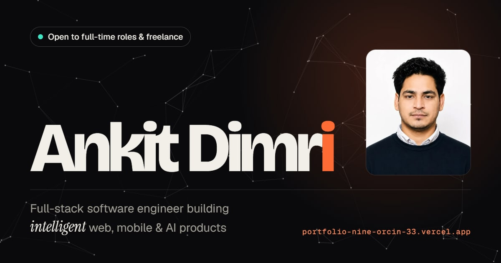
</a>

<sub>Click the preview to open the live site · <a href="https://portfolio-nine-orcin-33.vercel.app/resume-builder/">Resume builder</a> · <a href="https://portfolio-nine-orcin-33.vercel.app/brain-map/">Brain map</a> · <a href="https://portfolio-nine-orcin-33.vercel.app/resume">Resume (PDF)</a></sub>

</div>

> **This is the public part of my portfolio's code**, copied here from my private repository after every change. The resume builder, the call scheduler, sign-in and the admin view stay private, so this copy is for reading: it doesn't build on its own, and all rights are reserved ([LICENSE](LICENSE)).

---

## Highlights

- **Immersive, engineer-themed UI** — dark &amp; light themes, a fluid type system and a 12-column layout that uses the full width of laptops and large screens.
- **Hero** — the name decodes from binary (hover it to see the initials *A D* as `01000001 01000100`), a 3D code-editor card with parallax layers, and a node network that reacts to the cursor.
- **Live data** — GitHub commits/repos and LeetCode stats fetched server-side, cached, and shown with a "synced X min ago" indicator.
- **Scroll storytelling** — cards unfold into place, headlines flip up and the tech ribbons react to scroll speed — all compositor-only CSS, with a full reduced-motion fallback.
- **Resume builder** — [`/resume-builder/`](https://portfolio-nine-orcin-33.vercel.app/resume-builder/): three templates, a live preview that keeps the resume to one page, an ATS check (a score with tips, and which keywords of a job posting it has), and the PDF by email. Signing in with Google or an email link keeps drafts on any device.
- **Schedule a call** — the site's own scheduler: a month calendar, open times in the visitor's time zone (12h or 24h), and a booking straight into Google Calendar with a Google Meet link.
- **Email notifications** — every contact message and booking reaches my Gmail as a designed HTML email; contact messages are saved in PostgreSQL too, so none is lost if email fails.
- **Live brain map** — [`/brain-map/`](https://portfolio-nine-orcin-33.vercel.app/brain-map/): my work, projects and skills on one page, with a guided tour and a Light | Dark switch.
- **Resume from the same data** — every build prints the site's resume data into the one-page PDF at [`/resume`](https://portfolio-nine-orcin-33.vercel.app/resume), so the site and the resume never disagree.
- **Useful details** — certificate cover-flow with drag + lightbox, in-page interactive map of Dehradun, 12-hour IST clock, one-click email copy, accessible contact form.
- **Fast, accessible, SEO-ready** — Lighthouse 96 on mobile and 100 on desktop; Open Graph cards, JSON-LD, and a sitemap in Google Search Console.

---

## Screenshots

| | | |
|:---:|:---:|:---:|
| [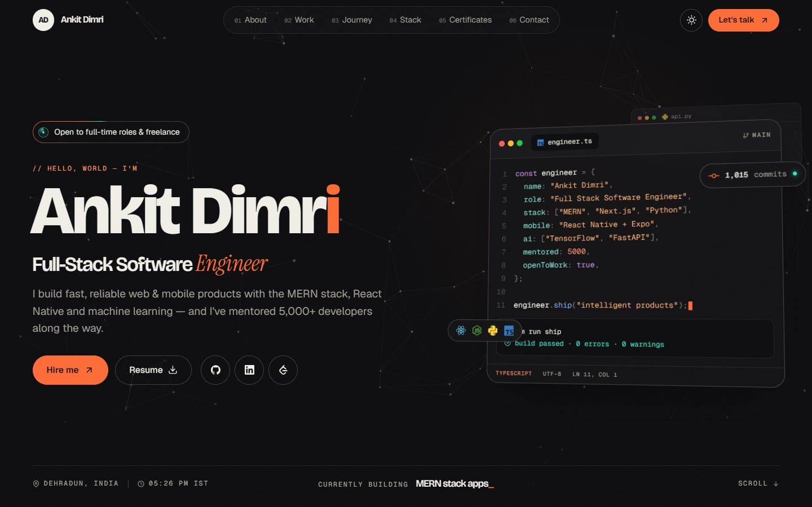](docs/screenshots/01-hero-dark.jpg)<br><sub>Hero · dark</sub> | [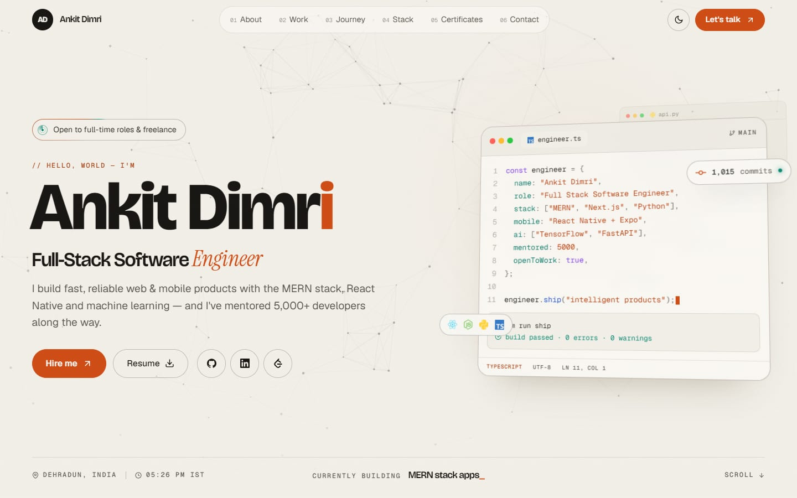](docs/screenshots/02-hero-light.jpg)<br><sub>Hero · light</sub> | [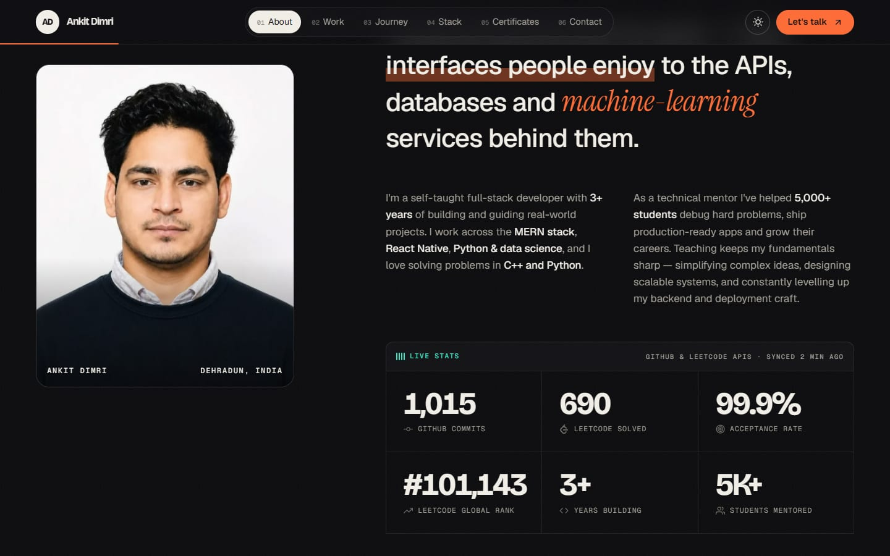](docs/screenshots/03-about-live-stats.jpg)<br><sub>About · live GitHub &amp; LeetCode stats</sub> |
| [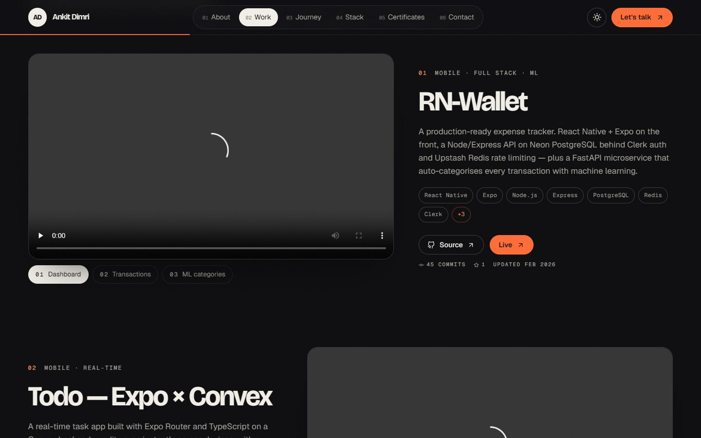](docs/screenshots/04-work.jpg)<br><sub>Selected work · demo videos</sub> | [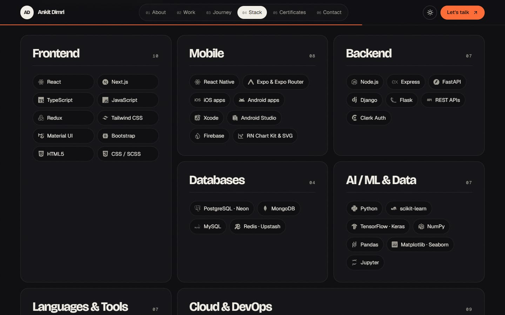](docs/screenshots/05-stack.jpg)<br><sub>Stack · bento grid</sub> | [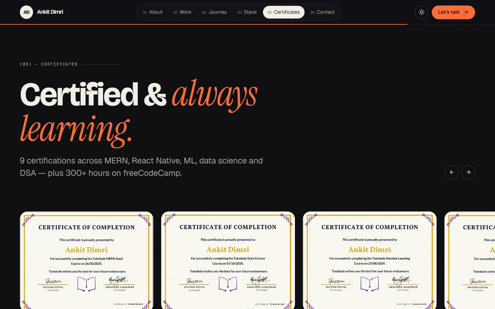](docs/screenshots/06-certificates.jpg)<br><sub>Certificates · cover-flow</sub> |
| [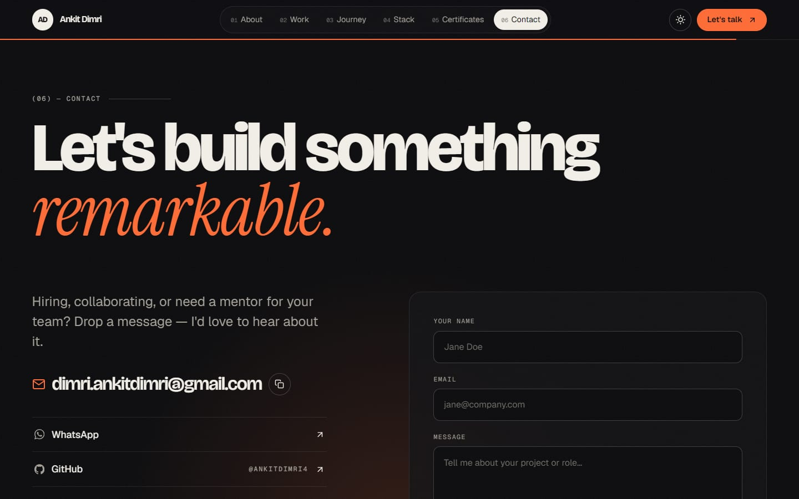](docs/screenshots/07-contact.jpg)<br><sub>Contact</sub> | [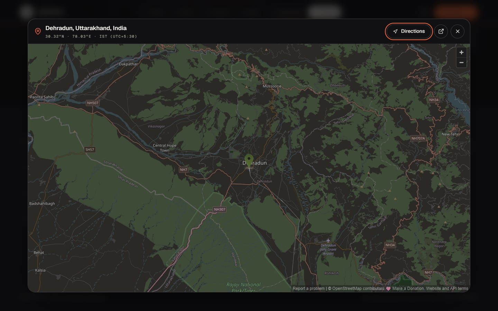](docs/screenshots/08-map-dialog.jpg)<br><sub>In-page full-screen map</sub> | [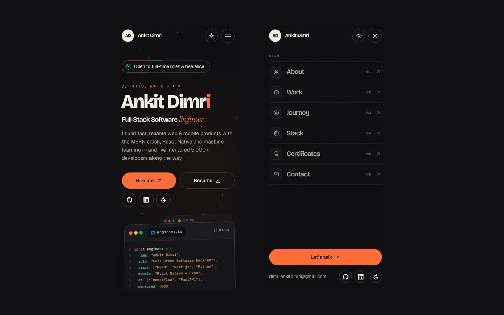](docs/screenshots/09-mobile.jpg)<br><sub>Mobile · hero &amp; menu</sub> |

### The live brain map

<a href="https://portfolio-nine-orcin-33.vercel.app/brain-map/" title="Open the live brain map">
  <picture>
    <source media="(prefers-color-scheme: dark)" srcset="https://raw.githubusercontent.com/AnkitDimri4/AnkitDimri4/main/assets/brain-map-dark.png">
    
  </picture>
</a>

<details>
<summary><b>The previous design</b> — a 29-second screen recording</summary>
<br>
<div align="center">
  <a href="docs/media/old-design.mp4" title="Open the recording of the previous design">
    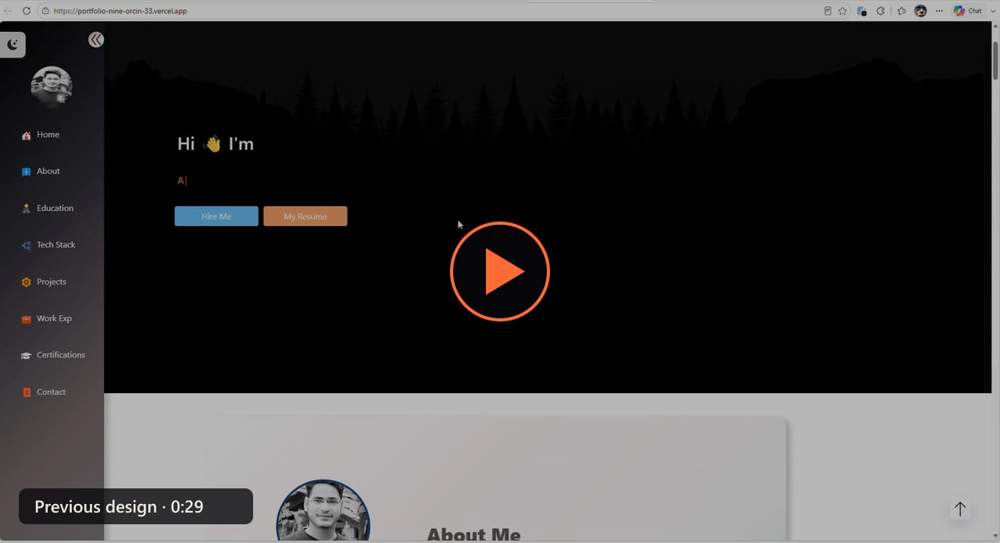
  </a>
</div>
</details>

---

## Performance

Lighthouse on the live site, mobile · desktop:

| Page | Performance | Accessibility | Best practices | SEO |
|---|---|---|---|---|
| Home | 96 · 100 | 100 · 97 | 100 · 100 | 100 · 100 |
| Resume builder | 96 · 100 | 100 · 100 | 100 · 100 | 100 · 100 |

On a phone (Lighthouse's slow 4G), the largest content shows in 2.3 seconds, nothing blocks the page for more than 10 ms, nothing shifts as it loads, and the builder loads 89 KB of JavaScript. What makes that possible:

- Pages are pre-rendered at build time, so the content arrives in the first response.
- Each page ships its own bundle, and the booking calendar loads only when someone opens it.
- Fonts are self-hosted and preloaded.
- Files are named by their content and cached for a year.

### Before → after the redesign

Lighthouse on the production build at the time:

| Metric | Previous design | New design |
|---|---|---|
| Performance (desktop / mobile) | 89 / 66 | **100 / ~90** |
| Accessibility | 76 | **100** |
| Best Practices | 96 | **100** |
| SEO | 92 | **100** |
| JavaScript (gzipped, initial) | 243 kB + jQuery/Bootstrap | **75 kB** (+33 kB icons, loaded on demand) |
| Total page weight | 1,918 kB · 50 requests | **~250 kB · 15 requests** |
| Largest Contentful Paint (mobile) | 6.4 s | **~2.9 s** |

### Build tooling: Create React App → Vite with pre-rendering

Same page and same machine, production builds served locally with compression. Lighthouse lab numbers vary from run to run on a laptop, so ranges across runs are shown.

| | CRA build | Vite build, pre-rendered |
|---|---|---|
| First HTML response | 2 kB, an empty `<div id="root">` | 22 kB gzipped, the full page |
| Content without JavaScript | none | **full page, painted in ~0.45 s** |
| Total Blocking Time, mobile | 120 – 1,450 ms | **140 – 170 ms** |
| Lighthouse Performance, mobile | 67 – 96 | **91** |
| Lighthouse Performance, desktop | 99 – 100 | 98 – 99 |
| Cumulative Layout Shift | 0.001 | **0** |
| Failing accessibility audits | 1 | **0** |
| Production build | ~60 s | **~1 s** |
| Installed dev dependencies | ~1,500 packages | **~200 packages** |

Lighthouse's simulated mobile First Contentful Paint reads later (0.8 s → 1.7 s). That is an effect of the first navigation in a cold browser: in a warm browser the two builds paint the same hero text within about 0.15 s of each other (0.44 s vs 0.58 s), and the pre-rendered page shows its content even where JavaScript is slow, blocked or off.

---

## Reliability

- The API can take a while to wake up. After 5 seconds the page says so; with no answer at all, a bar shows a timer and a Try now button, and whatever failed loads again once the server is back.
- A notice set from the admin view says what's paused. It's built into the page, so it shows even when the API is down.
- My resume and the notice are edited in the admin view and go live through a pull request: tests, a preview, then one-click approval.
- PDFs come from a function that downloads Chromium when it starts, which made each deployment about 90% smaller.

## Engineering

- 400+ tests, in Vitest and Node's test runner, with the API's SQL run on PGlite (PostgreSQL in memory).
- Every change on a branch and a pull request, with signed commits; GitHub Actions pinned to commit hashes, and Dependabot updates.
- Signed-in and admin routes check the session; HSTS and other security headers on every page, with a Content Security Policy that runs only the site's own scripts (its inline ones by their hashes, checked at every build), Razorpay's checkout and Google's sign-in button.
- Every API route has a rate limit per visitor (a test fails if one doesn't), under one ceiling for the whole API.

---

## Tech Stack

<p align="center">
  
  
  
  
  
  
  
  
  
  
  
  
  
  
</p>

| Frontend | Backend | Tooling &amp; hosting |
|---|---|---|
| React 18 + Vite, pre-rendered to static HTML | Node.js + Express | Vercel (frontend) |
| Hand-built CSS design system | PostgreSQL (Neon) via `pg` | Render (API) |
| CSS scroll-driven animations | Resend (email notifications) | GitHub &amp; LeetCode APIs |
| Canvas 2D (hero network) | In-memory caching &amp; rate limiting | Self-hosted fonts, WebP images |
| react-icons | dotenv, cors | Vitest + Testing Library, ESLint, `node:test` |
| | Google Calendar API + Meet (scheduler) | GitHub Actions (CI on pull requests) |

---

## What's in this repository

```
Portfolio/
├── client/                      # the React front end
│   ├── index.html               # SEO/meta, font loading, theme script; the app is pre-rendered into it
│   ├── public/                  # fonts, icons, og-image, sitemap, robots, and:
│   │   ├── brain-map/           # the live brain map (one static page)
│   │   └── privacy/, terms/     # the privacy page and the terms
│   ├── scripts/prerender.js     # renders the app to static HTML after `vite build`
│   ├── src/
│   │   ├── sections/            # Hero, About, Work, Journey, Stack, Certificates, Contact
│   │   ├── components/          # Nav, Footer (+ map dialog), CodeCard, Marquee, ServerBar, Notice…
│   │   ├── data/profile.js      # all site content: profile, projects, journey, certificates
│   │   ├── data/resume-data.js  # experience and the resume's content
│   │   ├── lib/                 # API client (shared cache, retries), theme, scroll-reveal helpers
│   │   ├── styles/              # global design tokens, scroll "unfold" animations
│   │   └── assets/              # optimised WebP images, certificates
│   └── vite.config.js, eslint.config.js, package.json
├── backend/                     # the API's public parts (Node.js + Express)
│   ├── controllers/             # the contact form, GitHub stats, LeetCode stats
│   ├── lib/                     # the contact form's checks, email through Resend
│   ├── middleware/rateLimit.js  # per-IP rate limiting (Cloudflare-aware on Render)
│   ├── config/db.js             # PostgreSQL (Neon) pool, verified TLS
│   ├── app.js, server.js        # security headers, CORS allow-list, a request ceiling, /health, JSON errors
│   └── test/                    # contact, mail, rate-limit and stats tests (node:test)
└── docs/                        # this README's screenshots, and the previous design's recording
```

More on each part: [client/README.md](client/README.md) and [backend/README.md](backend/README.md).

**Private, not in this copy:** the resume builder (with sign-in, My resumes and the admin view), its templates and PDF function, Schedule a call, the API's routes, and the docs.

---

## Author

**Ankit Dimri** — Full-Stack Software Engineer · 📍 Dehradun, India

[](https://github.com/AnkitDimri4)
[](https://www.linkedin.com/in/ankit-dimri-a6ab98263)
[](https://leetcode.com/u/user4612MW/)

---

<div align="center">
  Created by <b>Ankit Dimri</b> · © 2024–2026 · All rights reserved
</div>
